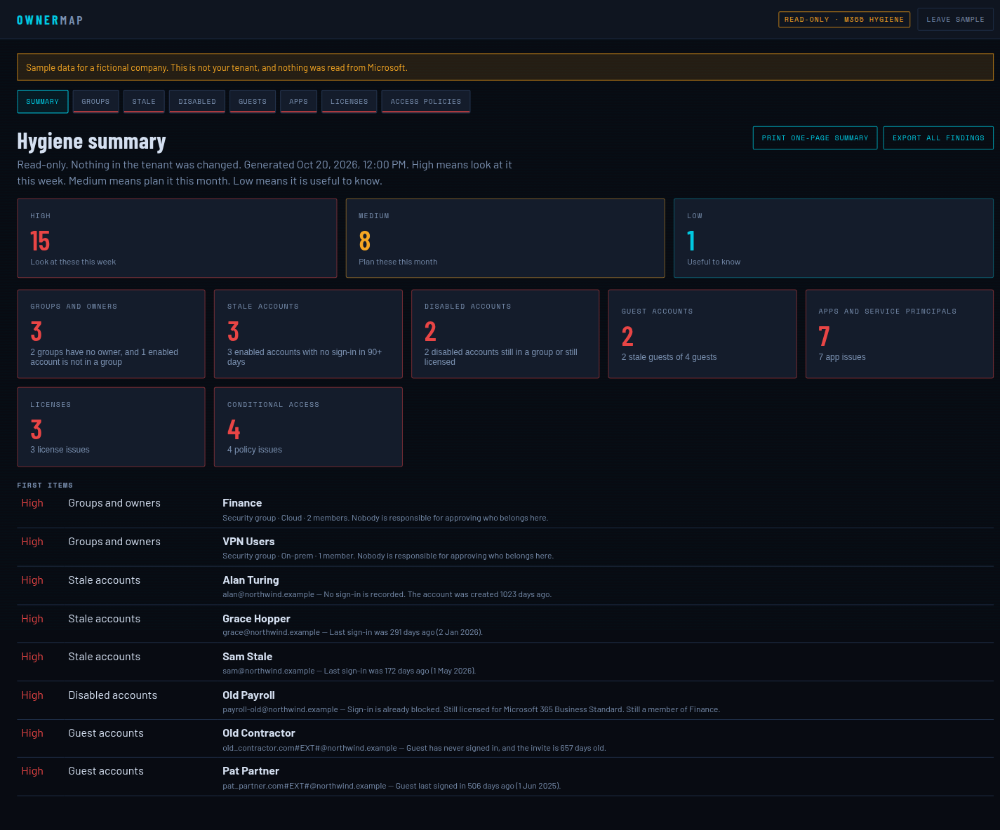

# OwnerMap

**A free, read-only Microsoft 365 and Entra hygiene check for small businesses.**

OwnerMap is the first tool in a planned Microsoft 365 admin suite. It is a static page: open it, sign in with Microsoft, and get a plain-language report. There is no server, no database, and no write access to the tenant. It is meant for IT generalists who do not have a security team.

The page maps group owners and members, then adds the checks a small tenant usually needs before an auditor, an insurer, or a leaver asks an awkward question.




## What it checks

| Check | What you get |
|---|---|
| Groups and owners | Every group, who owns it, who is in it, and a high finding when nobody owns it. Also counts enabled users who are not in any group. |
| Stale accounts | Enabled employees with no sign-in in 90 days. Uses `signInActivity`. Needs Entra ID P1 and `AuditLog.Read.All`. Skipped with a clear message when that is unavailable. |
| Disabled accounts | Blocked users who are still in a group, still own a group, or still hold a license. |
| Guest accounts | Every guest, with stale guests (no sign-in in 90 days, or invited 90+ days ago and never signed in) called out. |
| Apps and service principals | Your app registrations and enterprise apps: no owner, expired or soon-to-expire secrets and certificates (30 days), and high-privilege Microsoft Graph application permissions. Built-in Microsoft apps are left out of the owner noise. |
| Licenses | Purchased versus assigned seats, plus licenses sitting on disabled or stale people. Huge free catalogs such as Power BI Free are not treated as wasted seats. |
| Conditional Access | No turned-on policy requires MFA, legacy authentication is not blocked, policies left on report-only, and broad exclusions. Uses `Policy.Read.All`. Skipped with a clear message when the tenant has no Entra ID P1. If security defaults are on, the message says so. |

Each check explains what the result means and lists steps a non-security IT person can follow in the Microsoft 365 and Entra admin centers.

The summary counts high, medium, and low findings. **Print one-page summary** uses the browser print dialog (choose Save as PDF). **Export CSV** on each check downloads that table. **Export all findings** downloads every finding. CSV cells that start with `=`, `+`, `-`, `@`, or a tab are prefixed so Excel does not treat them as formulas.

## Permissions

Create one app registration and add these **delegated** Microsoft Graph permissions. Then click **Grant admin consent**. Do not add application permissions for OwnerMap, and do not add any permission whose name contains `Write`.

| Permission | Required | License | Why |
|---|---|---|---|
| `User.Read` | Yes | Any | Sign in and confirm the account running the check |
| `Group.Read.All` | Yes | Any | Read groups and their owners |
| `GroupMember.Read.All` | Yes | Any | Read group members |
| `User.Read.All` | Yes | Any | Read users, guests, enabled state, and assigned licenses |
| `Directory.Read.All` | Yes | Any | Read directory objects, on-prem sync flags, and subscribed licenses |
| `Application.Read.All` | Yes | Any | Read app registrations, enterprise apps, owners, and credentials |
| `AuditLog.Read.All` | No | Entra ID P1 or P2 | Read `signInActivity` for stale accounts and stale guests |
| `Policy.Read.All` | No | Entra ID P1 or P2 | Read Conditional Access policies and security defaults |

The signed-in person also needs a directory role that can read these objects. **Global Reader** is enough. OwnerMap cannot change users, groups, policies, or licenses.

### License requirements

- Groups, disabled accounts, guests (the list), apps, and license counts work on any Microsoft 365 tenant, including Business Basic.
- **Stale accounts and stale guests** need at least one **Entra ID P1** (or P2) license in the tenant, plus `AuditLog.Read.All`. Without that, Microsoft hides sign-in dates. The rest of the report still runs.
- **Conditional Access** needs **Entra ID P1** (or P2) and `Policy.Read.All`. Without P1 the check says so. If security defaults are turned on, the message explains what that does and what it does not do.

## Setup

### 1. Register the app

In the [Entra admin center](https://entra.microsoft.com): **Identity → Applications → App registrations → New registration**.

- **Name:** `OwnerMap`
- **Supported account types:** Accounts in this organizational directory only
- **Redirect URI:** choose **Web**, and paste the exact URL you will open. You can add it in the next step if you do not know it yet.

Open **API permissions → Add a permission → Microsoft Graph → Delegated permissions**, add the eight permissions in the table, then **Grant admin consent**.

Copy **Application (client) ID** and **Directory (tenant) ID** from the app's Overview page.

You do not create an application password. Sign-in uses the current user only, and the token stays in memory until you disconnect or close the tab.

### 2. Serve the page

Microsoft requires the redirect URI to match the address bar exactly, including `ownermap.html` and without a trailing slash difference.

**GitHub Pages** (a stable link for the IT team):

1. Fork this repo or push it to your own GitHub account.
2. **Settings → Pages → Source:** the `main` branch, `/ (root)`, Save.
3. Open `https://yourusername.github.io/OwnerMap/ownermap.html`.
4. On the app registration, **Authentication → Add a platform → Web**, paste that URL, Save.

**A local web server** (a one-off check on your machine):

```bash
python3 -m http.server 8080
```

Open `http://localhost:8080/ownermap.html`. Register that URL as a Web redirect URI. Stop the server with Ctrl+C when you are done.

| How you open it | Redirect URI |
|---|---|
| GitHub Pages | `https://yourusername.github.io/OwnerMap/ownermap.html` |
| Local Python server | `http://localhost:8080/ownermap.html` |

### 3. Run the check

Open the URL you registered. Enter the tenant ID and client ID. Choose **Sign in and run the check**. If you are already signed in to Microsoft 365, the prompt may be brief. **Preview with sample data** shows a fictional tenant and does not contact Microsoft.

## How to read the report

- **Summary** — high, medium, and low counts, one card per check, and the first items to open.
- **Each check** — what it means, how to fix it in the admin center, the findings, and a searchable table.
- **Groups** — click a row for owners and members. **Export unassigned users** downloads enabled employees who are not direct members of any group.
- **Print one-page summary** — the browser print dialog. Choose Save as PDF for a one-page handout.
- **Export CSV** — that check's table. **Export all findings** — every finding and its fix steps.

A check that says **Not checked** did not fail open. Sign-in dates or Conditional Access were skipped because of licensing or consent. The message on that tab says which one.

## Security posture

- Static files only. No backend, and suitable for GitHub Pages.
- Delegated Microsoft Graph only. The signed-in user's own rights apply.
- No write permissions are requested, and the page never sends a change to Graph.
- Tokens are stored with MSAL `cacheLocation: 'memory'`. Disconnecting drops them.
- Content-Security-Policy allows scripts from this site and the pinned MSAL file on jsDelivr, styles from this page and Google Fonts, and connections only to `login.microsoftonline.com` and `graph.microsoft.com`. Frames are limited to the Microsoft login host. `object-src`, `base-uri`, and `form-action` are `none`. `frame-ancestors` is `none`.
- The MSAL script tag uses subresource integrity.
- Tenant ID and client ID are checked as GUIDs before sign-in.
- Graph calls are refused unless the URL starts with `https://graph.microsoft.com/`.
- Text from the directory is escaped before it is shown.
- CSV formula injection is neutralized.
- The URL hash is cleared if a token lands in it.

## Tests

The classification, severity, and CSV rules live in `src/hygiene.js` with no network and no browser. Tests feed mocked Graph responses, including the sample tenant.

```bash
node --test tests/hygiene.test.js
```

Node.js 22 or newer is enough. There is no package to install.

## What this page does not do

- It does not change the tenant, assign owners, remove licenses, or edit Conditional Access.
- It does not read on-premises Active Directory directly. Groups synced by Entra Connect appear and are marked On-prem. Groups that were never synced do not appear.
- It does not replace a full audit. It is a hygiene pass you can run in an afternoon.

## Roadmap

Later tools in this suite stay read-only unless a future version is a separate, explicit admin action. Ideas already queued:

- A quarterly reminder that reuses this report
- On-premises groups that Entra Connect does not sync
- A second page for SharePoint sharing links

## License

MIT. See [LICENSE](LICENSE).
