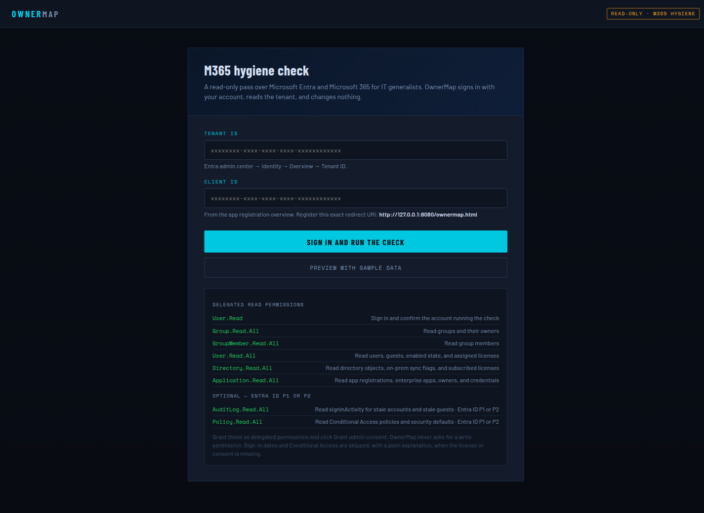

# Set up OwnerMap in your tenant

This guide is for the IT person at a small business who has to register OwnerMap once, then hand the page to whoever runs the hygiene check. You do this yourself in your own Microsoft Entra tenant. OwnerMap is a free static page. There is no paid setup service, and there is nothing to buy from this project to finish the steps below.

When you are done you will have:

- One single-tenant app registration (the usual name is `OwnerMap`).
- The page URL registered as a **Single-page application** redirect URI.
- Eight **delegated** Microsoft Graph permissions, all read-only.
- Tenant-wide admin consent for those permissions.
- A browser page where someone with a directory reader role can sign in and run the check.

OwnerMap never changes users, groups, licenses, or policies. Do not add a permission whose name contains `Write`. Do not create an application password. Skip **Certificates & secrets**.

The short version on the project front page is [the README setup section](../README.md). This page is the one to follow the first time.

## Who needs which role

Two different jobs get mixed together. Registering the app is one job. Granting tenant-wide admin consent is another. The same person can do both when they hold a role that covers both rows. A person who can only register the app still has to send the consent link to someone in the consent row.

Microsoft documents these roles on the following pages. They were checked against the live articles on 20 October 2026. If a portal label does not match this table, trust the current article and send that page with your request.

- [Grant tenant-wide admin consent to an application](https://learn.microsoft.com/en-us/entra/identity/enterprise-apps/grant-admin-consent) (prerequisites)
- [Least privileged roles by task](https://learn.microsoft.com/en-us/entra/identity/role-based-access-control/delegate-by-task) (application registration, and "Consent to any delegated permissions")
- [Delegate application management](https://learn.microsoft.com/en-us/entra/identity/role-based-access-control/delegate-app-roles) (who can register apps when the default is turned off)
- [Microsoft Entra built-in roles](https://learn.microsoft.com/en-us/entra/identity/role-based-access-control/permissions-reference) (Application Developer, Cloud Application Administrator, Application Administrator, Global Administrator)

| Job | Who can do it |
|---|---|
| Register the OwnerMap app, or run `scripts/Register-OwnerMap.ps1` | Any user in the tenant, while **Users can register applications** is **Yes**. That is the default. When that setting is **No**, Microsoft lists **Application Developer** as the least privileged role, and also **Cloud Application Administrator** and **Application Administrator**. **Global Administrator** can register apps as well, because that role can manage all aspects of Microsoft Entra ID. |
| Grant tenant-wide admin consent for OwnerMap's Microsoft Graph **delegated** permissions | **Cloud Application Administrator** is the least privileged built-in role Microsoft lists for consenting to delegated permissions. **Application Administrator**, **AI Administrator**, and **Privileged Role Administrator** can also grant it. So can a custom directory role that includes granting permissions to applications, for the permissions this app requests. **Global Administrator** can grant this consent as well. **Application Developer** can register the app and can consent only on their own behalf. That is not tenant-wide admin consent. |
| Run the hygiene check later | **Global Reader** is enough to read the directory. The person signs in on the page with their own work account. They do not need to be allowed to register apps. |

OwnerMap asks only for delegated permissions (the app acts as the signed-in person). Microsoft Graph **application** permissions, also called app roles, are a higher bar: Microsoft lists **Privileged Role Administrator** for consent to Microsoft Graph application permissions, and notes that some tenants still need a Global Administrator for that. Do not add those. OwnerMap does not use them, and this guide does not ask you to grant them.

> **Screenshot placeholder**
>
> Replace this box with a picture from your own admin center if you need to show a colleague which setting is on.
>
> **Where to click:** Entra admin center, **Identity > Users > User settings**.
>
> **What the picture should show:** **Users can register applications** set to Yes or No. If it is No, the person who runs the script needs Application Developer, Cloud Application Administrator, Application Administrator, or Global Administrator.

## Where to put the page

Pick one host before you register the app. The redirect URI is the exact address of `ownermap.html` in the browser. The script asks you to pass it. The portal asks you to paste it.

The address must match character for character: `https` or `http`, the host, the folder, and `ownermap.html`. A trailing slash is a different URI. A query string such as `?demo=1` is not part of the registered URI.

Microsoft sign-in allows `http://` only for `localhost` (and `127.0.0.1`). Any other hostname, including an internal server name and an Azure name, must be `https://`. Opening the file from Explorer uses `file://` and sign-in will fail.

You can register more than one address on the same app. A common pair is the localhost URL and the shared server URL. Pass every URL on one command. The script replaces the redirect list with exactly the URLs you pass.

| | Local admin PC | Azure Static Web Apps, Free | Internal web server |
|---|---|---|---|
| Choose this when | One admin runs the check on their own PC | The team wants one `https` link and the company can use Azure | The page should stay on the company network, and a Windows or Linux web server is already there |
| Who can open it | Only that PC, while the command is running | Anyone with the link | People who can reach that server (office network or VPN) |
| Address to register | `http://localhost:8080/ownermap.html` | `https://<name>.azurestaticapps.net/ownermap.html` | `https://ownermap.yourcompany.local/ownermap.html` |
| Account you need | None beyond the Entra role in the table above | An Azure subscription. No GitHub account | An admin login on the web server |
| Certificate | None. Localhost is the exception to HTTPS | Azure creates one, including a custom domain on the Free plan | A certificate the staff PCs already trust |

Replace `yourcompany.local` and `<name>` with the real names from your own setup.

### 1. Local admin PC

Use this when you only need the check on one computer. Nothing is published to the internet. The page stops when you stop the command.

You need two things side by side in one folder:

- `ownermap.html`
- a `src` folder with `hygiene.js` and `sample-tenant.js`

If a Release is listed on the project site, download that zip. Otherwise open the project page and use **Download ZIP**. A GitHub account is not required for a public download. Unzip it. Do not open `ownermap.html` from the desktop. That uses `file://`.

**Windows, no extra install.** Open PowerShell in the unzipped folder (the folder that contains `ownermap.html` and `scripts`) and run:

```powershell
powershell -NoProfile -ExecutionPolicy Bypass -File .\scripts\Serve-OwnerMap.ps1
```

**Python, if it is already installed.** From that same folder:

```powershell
py -m http.server 8080
```

On a Mac or Linux admin PC:

```bash
python3 -m http.server 8080
```

Leave the window open. In the browser, open `http://localhost:8080/ownermap.html`.

The Single-page application redirect URI for this option is:

```text
http://localhost:8080/ownermap.html
```

Use `localhost` in both the browser and the app registration. `http://127.0.0.1:8080/ownermap.html` is a different URI. If you change the port, change the registered URI to the same port. Stop the server with Ctrl+C when you are done. Starting it again does not require a new app registration if the URL is unchanged.

> **Screenshot placeholder**
>
> Replace this box with a picture of your own PowerShell or Python window and the browser address bar.
>
> **Where to click:** the folder that contains `ownermap.html`, then the serve command above.
>
> **What the picture should show:** The command still running, and the browser address `http://localhost:8080/ownermap.html` with the OwnerMap sign-in page visible.

### 2. Azure Static Web Apps, Free plan

Use this when several people should open the same link, including from home, and the company has an Azure subscription. The Free plan is enough for this page. It includes the `azurestaticapps.net` address, a certificate, and up to two custom domains. It does not include a service-level agreement. You do not connect GitHub or Azure DevOps.

The page stays in the browser. Azure only stores the HTML and JavaScript files. Do not add an API, Azure Functions, or the Static Web Apps login feature. OwnerMap signs in with Microsoft from the browser. The deployment token only lets someone upload files. Treat it like a password.

Someone who can create resources in the subscription does these steps. Contributor on the resource group is the usual role. That Azure role is separate from the Entra roles in the table above.

1. Sign in to the [Azure portal](https://portal.azure.com).
2. Select **Create a resource**, search for **Static Web App**, and select **Create**.
3. Choose the subscription and a resource group. A new group named `ownermap` is fine.
4. Name the app `ownermap`, or a name your company prefers. Pick the region closest to the office.
5. Hosting plan: **Free**.
6. Under **Deployment details**, set the source to **Other**. Do not sign in to GitHub. Create the app.
7. Open the new Static Web App. On **Overview**, select **Manage deployment token** and copy the token into a local note. You need it once, for the upload. Do not email it, and do not paste it into a chat.

> **Screenshot placeholder**
>
> Replace this box with a picture from your own Azure portal. Hide the deployment token if it is on screen.
>
> **Where to click:** Create Static Web App, then the new app's Overview page.
>
> **What the picture should show:** Hosting plan Free, deployment source Other, and the `https://....azurestaticapps.net` URL on Overview.

**Upload the files.** The folder you upload must contain `ownermap.html` and the `src` folder. If the portal shows **Deployment** with a manual upload or a place to drop a folder, use that and choose this folder.

If the portal has no upload box, use the Static Web Apps CLI. That is the upload method Microsoft documents when the source is Other.

1. On the admin PC, install the Node.js LTS installer from [https://nodejs.org](https://nodejs.org), then close and reopen PowerShell. On a current Windows PC you can instead run `winget install OpenJS.NodeJS.LTS` and open a new window.
2. Change to the unzipped OwnerMap folder.
3. Run the upload. Replace the token. `--env production` matters. Without it, the files land on a preview address and the redirect URI will not match.

```powershell
npx --yes @azure/static-web-apps-cli deploy . --deployment-token PASTE-TOKEN-HERE --env production
```

4. When it finishes, go back to **Overview** and copy the URL, which looks like `https://happy-name-12345.azurestaticapps.net`.
5. Open `https://happy-name-12345.azurestaticapps.net/ownermap.html`. The file name is required. The site root is not the page.

The Single-page application redirect URI is that full address, for example:

```text
https://happy-name-12345.azurestaticapps.net/ownermap.html
```

**Custom domain, optional.** Use this when you want a name such as `ownermap.contoso.com`. The Free plan includes the certificate. The DNS record has to be visible on the public internet, because Azure uses it to prove you own the name and to renew the certificate. A name that exists only in internal DNS will not work here. Host that name on your internal web server instead.

1. On the Static Web App, open **Custom domains** and add the hostname, for example `ownermap.contoso.com`.
2. At the public DNS host, create the CNAME record the portal shows. It points your name at the `azurestaticapps.net` hostname.
3. Wait until the portal says the domain is ready and the certificate is issued.
4. Open `https://ownermap.contoso.com/ownermap.html`.
5. Register that exact URL as well. If people will use both the Azure hostname and the custom domain, pass both to the script. Passing only the new one removes the old one.

Details Microsoft maintains: [Custom domains with Azure Static Web Apps](https://learn.microsoft.com/en-us/azure/static-web-apps/custom-domain) and [Deploy with the Static Web Apps CLI](https://learn.microsoft.com/en-us/azure/static-web-apps/static-web-apps-cli-deploy).

### 3. Internal web server

Use this when the page should be reachable by the IT team on the company network, and you already run IIS, nginx, or Apache. The hostname in this section is an example. Use yours, and use the same name in DNS, on the certificate, and in the redirect URI.

Example redirect URI:

```text
https://ownermap.contoso.local/ownermap.html
```

`http://ownermap.contoso.local/ownermap.html` will not work for sign-in. Microsoft rejects `http://` for every host except localhost.

Copy `ownermap.html` and the `src` folder onto the server. Keep them side by side. The examples below use `C:\inetpub\ownermap` on Windows and `/var/www/ownermap` on Linux.

Create an internal DNS record so `ownermap.contoso.local` points at this server. The certificate must be for that same name, and the PCs that open the page must trust the authority that issued it. A certificate from the company's internal CA is the right choice. A self-signed certificate works only after you distribute it to **Trusted Root Certification Authorities** on those PCs (Group Policy does this for domain-joined Windows computers). Until the browser trusts the certificate, the sign-in window can fail even after the person clicks through the warning.

#### IIS on Windows Server

1. Install the web server if this machine does not have it yet. In an elevated PowerShell window:

```powershell
Install-WindowsFeature Web-Server, Web-Static-Content
```

2. Create `C:\inetpub\ownermap` and copy in `ownermap.html` and the `src` folder.
3. Save the following as `C:\inetpub\ownermap\web.config`. It sets the file types and makes `ownermap.html` the default document. IIS usually already knows `.js`. The remove-and-add lines keep the site from failing when the type is already defined.

```xml
<?xml version="1.0" encoding="UTF-8"?>
<configuration>
  <system.webServer>
    <defaultDocument>
      <files>
        <clear />
        <add value="ownermap.html" />
      </files>
    </defaultDocument>
    <staticContent>
      <remove fileExtension=".js" />
      <mimeMap fileExtension=".js" mimeType="text/javascript" />
      <remove fileExtension=".json" />
      <mimeMap fileExtension=".json" mimeType="application/json" />
    </staticContent>
  </system.webServer>
</configuration>
```

4. Open **IIS Manager**. Select the server name, then **Server Certificates**.
   - Internal CA: import the `.pfx` the CA gave you, or use **Create Domain Certificate** if this server is set up to request one.
   - No CA yet: **Create Self-Signed Certificate**, friendly name `ownermap`. Then export it and trust it on the PCs, as described above.
5. Right-click **Sites**, then **Add Website**.
   - Site name: `OwnerMap`
   - Physical path: `C:\inetpub\ownermap`
   - Type: **https**
   - Port: **443**
   - Host name: `ownermap.contoso.local`
   - SSL certificate: the certificate from the previous step
6. Allow HTTPS from the staff network:

```powershell
New-NetFirewallRule -DisplayName 'OwnerMap HTTPS' -Direction Inbound -Protocol TCP -LocalPort 443 -Action Allow
```

7. On a staff PC, open `https://ownermap.contoso.local/ownermap.html`. The address bar must show a lock, with no certificate warning. Register that exact URL.

> **Screenshot placeholder**
>
> Replace this box with a picture from your own IIS Manager.
>
> **Where to click:** Sites > OwnerMap > Bindings.
>
> **What the picture should show:** An https binding on port 443, the host name you will register, and the certificate selected. No token or password in the picture.

To confirm the MIME types in the manager: select the OwnerMap site, open **MIME Types**, and check that `.js` is `text/javascript` and `.json` is `application/json`. The `web.config` above sets both.

#### Linux with nginx

1. Install nginx if it is not already the site's web server. On Ubuntu or Debian: `sudo apt install nginx`.
2. Copy the files to `/var/www/ownermap/` so these paths exist: `/var/www/ownermap/ownermap.html` and `/var/www/ownermap/src/hygiene.js`. Let the web server read them: `sudo chmod -R a+rX /var/www/ownermap`.
3. Put the certificate and private key on the server, for example `/etc/ssl/certs/ownermap.crt` and `/etc/ssl/private/ownermap.key`. Restrict the key: `sudo chmod 640 /etc/ssl/private/ownermap.key`.
4. Create `/etc/nginx/sites-available/ownermap` with this site. Replace the hostname and certificate paths.

```nginx
server {
    listen 443 ssl;
    server_name ownermap.contoso.local;

    ssl_certificate     /etc/ssl/certs/ownermap.crt;
    ssl_certificate_key /etc/ssl/private/ownermap.key;

    root /var/www/ownermap;
    index ownermap.html;

    include /etc/nginx/mime.types;

    location / {
        try_files $uri $uri/ =404;
    }
}
```

`mime.types` already serves `.html` as `text/html` and `.js` as JavaScript. The include line is what makes that apply to this site.

5. Enable the site, test the config, and reload:

```bash
sudo ln -s /etc/nginx/sites-available/ownermap /etc/nginx/sites-enabled/ownermap
sudo nginx -t
sudo systemctl reload nginx
```

6. If a firewall is on, allow TCP 443. With ufw: `sudo ufw allow 443/tcp`.
7. Open `https://ownermap.contoso.local/ownermap.html` from a staff PC and register that exact URL.

#### Linux with Apache

1. Install Apache if this is the server you use. On Ubuntu or Debian: `sudo apt install apache2` and `sudo a2enmod ssl`.
2. Use the same folder and certificate files as the nginx steps.
3. Create `/etc/apache2/sites-available/ownermap.conf`:

```apache
<VirtualHost *:443>
    ServerName ownermap.contoso.local
    DocumentRoot /var/www/ownermap

    SSLEngine on
    SSLCertificateFile /etc/ssl/certs/ownermap.crt
    SSLCertificateKeyFile /etc/ssl/private/ownermap.key

    DirectoryIndex ownermap.html
    AddType text/javascript .js
    AddType application/json .json

    <Directory /var/www/ownermap>
        Require all granted
    </Directory>
</VirtualHost>
```

4. Enable the site and reload:

```bash
sudo a2ensite ownermap.conf
sudo apachectl configtest
sudo systemctl reload apache2
```

5. Allow TCP 443 if a firewall is on, then open `https://ownermap.contoso.local/ownermap.html` and register that exact URL.

Optional. If the company already uses GitHub Pages for an internal tool, that host can serve this page too. Register the `https` address of `ownermap.html` as a Single-page application redirect. A GitHub account is not required for the three options above.

## Recommended path: PowerShell

Use this when the person registering the app can run PowerShell and sign in to the tenant. The manual portal steps further down are the alternative when they cannot.

The script file is [`scripts/Register-OwnerMap.ps1`](../scripts/Register-OwnerMap.ps1).

### What it will do, before it changes anything

Read this before you sign in. The script prints the same plan, and `-WhatIf` prints it without signing in.

It will:

- Sign you in with the delegated permission `Application.ReadWrite.All`. That permission is for **you**, so you can create the registration. It is **not** added to OwnerMap.
- Create one single-tenant app, or update the existing app with the same display name (default `OwnerMap`). If several apps already share that name, it stops and asks you to pass `-ClientId`.
- Set the platform to **Single-page application** and set the redirect URI list to exactly the URLs you passed. If one of those URLs was previously saved under **Web** or a public client, it moves that URL onto the single-page platform. The same URL cannot sit on two platforms.
- Set Microsoft Graph permissions to exactly these eight **delegated** scopes, and drop extra Microsoft Graph permissions from this app on update:
  - `User.Read`
  - `Group.Read.All`
  - `GroupMember.Read.All`
  - `User.Read.All`
  - `Directory.Read.All`
  - `Application.Read.All`
  - `AuditLog.Read.All`
  - `Policy.Read.All`
- Print the application (client) ID, the directory (tenant) ID, and an admin consent URL.

It will not:

- Grant admin consent. You still do that in the next section, or you send the URL to someone who can.
- Add any permission with `Write` in the name to OwnerMap.
- Add an application permission (an app role).
- Create a client secret or a certificate.
- Change users, groups, licenses, Conditional Access, or anything else in the directory.
- Open the hygiene check or sign in as the person who will run the report.

Running it again with the same name and the same URLs updates the same registration. It does not create a second app. Pass every redirect URI you still want. The redirect list is replaced by what you pass this time.

### Install the two modules

Use Windows PowerShell 5.1 or PowerShell 7. Run:

```powershell
Install-Module Microsoft.Graph.Authentication -Scope CurrentUser
Install-Module Microsoft.Graph.Applications -Scope CurrentUser
```

If PowerShell says PSGallery is untrusted, that first-time prompt is expected. Answer Yes to install these two modules.

You do not need to install the whole `Microsoft.Graph` meta-module.

### Preview, then run

Open PowerShell in the OwnerMap folder (the folder that contains `scripts` and `ownermap.html`). If the script will not start because of execution policy, allow it for this window only:

```powershell
Set-ExecutionPolicy -Scope Process -ExecutionPolicy Bypass
```

Preview without signing in:

```powershell
.\scripts\Register-OwnerMap.ps1 -RedirectUri 'http://localhost:8080/ownermap.html' -WhatIf
```

Create or update the app. PowerShell prints the plan, asks you to confirm, and then opens a sign-in window. The sign-in account must be allowed to register applications (see the role table). The confirmation is there because the script changes an app registration.

Local page only:

```powershell
.\scripts\Register-OwnerMap.ps1 -RedirectUri 'http://localhost:8080/ownermap.html'
```

Azure or an internal server. Use the URL you actually open:

```powershell
.\scripts\Register-OwnerMap.ps1 -RedirectUri 'https://ownermap.contoso.local/ownermap.html'
```

Localhost and the shared name on one registration. Pass every address people will open. This command replaces the whole redirect list:

```powershell
.\scripts\Register-OwnerMap.ps1 -RedirectUri 'http://localhost:8080/ownermap.html','https://ownermap.contoso.local/ownermap.html'
```

Update a specific app instead of searching by name:

```powershell
.\scripts\Register-OwnerMap.ps1 -ClientId 'aaaaaaaa-bbbb-cccc-dddd-eeeeeeeeeeee' -RedirectUri 'https://ownermap.contoso.local/ownermap.html'
```

Copy the **Client ID**, **Directory tenant ID**, and **Admin consent URL** from the output. The script then signs you out of Microsoft Graph PowerShell.

## Grant admin consent

The registration lists the eight permissions. They do nothing for other users until an admin grants tenant-wide consent.

1. Sign in as someone from the consent row of the role table. Cloud Application Administrator is the least privileged built-in role for this delegated consent.
2. Open the admin consent URL the script printed. It looks like this, with your ids filled in:

```text
https://login.microsoftonline.com/{tenant-id}/adminconsent?client_id={client-id}
```

3. Read the list. You should see the eight delegated permissions and nothing that says `Write`. Accept.

Or use the portal: **Identity > Applications > App registrations > OwnerMap > API permissions > Grant admin consent for your organization**. Confirm the status column says **Granted for** your organization on each of the eight rows.

> **Screenshot placeholder**
>
> Replace this box with a picture from your own admin center after consent is granted.
>
> **Where to click:** App registrations > OwnerMap > API permissions.
>
> **What the picture should show:** Eight Microsoft Graph **delegated** permissions (`User.Read`, `Group.Read.All`, `GroupMember.Read.All`, `User.Read.All`, `Directory.Read.All`, `Application.Read.All`, `AuditLog.Read.All`, `Policy.Read.All`), each with admin consent granted. No application permissions. No permission with `Write` in the name.

`AuditLog.Read.All` and `Policy.Read.All` are optional at run time. Consent to them anyway. If the tenant has no Entra ID P1, those two checks explain themselves and the rest of the report still runs.

### If you are not allowed to grant consent

Register the app if you can (the script, or the portal steps). Then email the consent URL to someone in the consent row. Do not send them your password, and do not send a token.

**Subject:** Please grant admin consent for OwnerMap (read-only)

**Body:**

```text
I registered a single-tenant app called OwnerMap so we can run a read-only
Microsoft 365 hygiene check in the browser. It does not change users, groups,
licenses, or policies, and it does not use an application password.

Please open this URL while signed in as a Cloud Application Administrator,
Application Administrator, AI Administrator, Privileged Role Administrator,
or Global Administrator:

https://login.microsoftonline.com/{tenant-id}/adminconsent?client_id={client-id}

Accept only these eight Microsoft Graph delegated permissions:
User.Read, Group.Read.All, GroupMember.Read.All, User.Read.All,
Directory.Read.All, Application.Read.All, AuditLog.Read.All, Policy.Read.All.

Please do not add a permission with Write in the name, and do not create a
client secret.

The Application (client) ID is: {client-id}
The Directory (tenant) ID is: {tenant-id}
```

If your tenant already uses **Admin consent requests** (**Identity > Applications > Enterprise applications > Consent and permissions > Admin consent settings**), the blocked person can submit a request there instead. The reviewer still has to hold one of the consent roles above. The email works either way.

> **Screenshot placeholder**
>
> Replace this box with a picture of the consent window your admin sees. Do not include the address bar if it contains a code.
>
> **Where to click:** the admin consent URL, signed in as a role from the consent row.
>
> **What the picture should show:** OwnerMap asking for the eight delegated Microsoft Graph permissions, and the Accept button. No write permissions on the list.

## Alternative: register the app in the portal

Use this when you cannot run the PowerShell script. The result should match what the script creates. The platform is **Single-page application**. A **Web** platform causes sign-in errors `AADSTS9002326` and `AADSTS9002325`, because this page uses the browser sign-in flow with PKCE.

1. Open the [Entra admin center](https://entra.microsoft.com) as someone who is allowed to register applications.
2. Go to **Identity > Applications > App registrations > New registration**.
3. Name: `OwnerMap`.
4. Supported account types: **Accounts in this organizational directory only**.
5. Redirect URI: choose **Single-page application (SPA)**, and paste the exact `ownermap.html` URL from the hosting section. Register.
6. On **Overview**, copy **Application (client) ID** and **Directory (tenant) ID**.
7. Open **Authentication**. Confirm the URL is listed under **Single-page application**, not under **Web**. Leave implicit grant and hybrid flows unchecked. Do not create a secret under **Certificates & secrets**.
8. Open **API permissions > Add a permission > Microsoft Graph > Delegated permissions**. Add the eight scopes listed above. Do not open **Application permissions**.
9. Choose **Grant admin consent**, or send the consent request in the previous section.

> **Screenshot placeholder**
>
> Replace this box with a picture from your own admin center.
>
> **Where to click:** App registrations > New registration.
>
> **What the picture should show:** Name `OwnerMap`, accounts in this organizational directory only, and the redirect platform set to **Single-page application** with the full `ownermap.html` URL.

> **Screenshot placeholder**
>
> Replace this box with a picture from your own admin center.
>
> **Where to click:** the new app's **Overview**.
>
> **What the picture should show:** Application (client) ID and Directory (tenant) ID. Those two values are what the sign-in page asks for.

> **Screenshot placeholder**
>
> Replace this box with a picture from your own admin center.
>
> **Where to click:** the app's **Authentication** page.
>
> **What the picture should show:** The page URL under **Single-page application**. The **Web** section should not contain that same URL.

To add a second URL later, open **Authentication** and add another **Single-page application** URI, or run the script again and pass every URL you still want, such as localhost and the internal hostname.

## First run

1. Open the URL you registered. It must be the `ownermap.html` address, not a different folder and not `file://`.
2. Paste the **Directory (tenant) ID** and the **Application (client) ID**.
3. Choose **Sign in and run the check**. If you are already signed in to Microsoft 365, the prompt may be short. Use a work account from this tenant.
4. **Preview with sample data** loads a fictional company and does not contact Microsoft. You can use it to learn the report before consent is finished. On a local server the preview address is `http://localhost:8080/ownermap.html?demo=1`. Do not register the `?demo=1` part as the redirect URI.

The sign-in screen looks like this:



The person who runs the check needs a reader role such as Global Reader. They do not need permission to edit the app.

## Ask your AI assistant

You can paste the prompt below into ChatGPT, Claude, or Grok, then paste this guide (or the part you are stuck on) underneath it. The assistant should walk one step at a time and explain errors. It is a helper for reading this document. It cannot click the portal for you, and it is not a setup service.

**Never paste tokens or secrets into a chat.** That includes access tokens, refresh tokens, authorization codes, client secrets, passwords, the Azure Static Web Apps deployment token, and any sign-in URL that contains `code=`, `access_token`, or `id_token`. If a URL looks long and contains those words, delete the query string before you copy it. An error code such as `AADSTS50011` is safe to paste. A client ID and a tenant ID are safe to paste. A token is not.

```text
You are helping a junior IT person set up OwnerMap, a free read-only
Microsoft 365 and Entra hygiene check, in their own work tenant. They will
paste docs/SETUP.md from the OwnerMap repository, or the section they are
stuck on.

Walk them through that guide one step at a time. Wait until they tell you
what they see before you give the next click or command. Explain errors in
plain language, including AADSTS codes, and name the troubleshooting row
that matches.

Use the PowerShell script (scripts/Register-OwnerMap.ps1) as the recommended
way to register the app. Use the manual portal steps only if they cannot
run the script. The script accepts one or more -RedirectUri values, and
-WhatIf prints the plan without signing in.

Hosting is one of these three, and only these three, unless they already
said they use another host:
1. Local admin PC, http://localhost, using scripts/Serve-OwnerMap.ps1 or
   a one-line Python server.
2. Azure Static Web Apps on the Free plan, created in the Azure portal
   with deployment source Other, then uploaded with the portal upload or
   the SWA CLI. No GitHub account.
3. An internal web server: IIS, or Linux with nginx or Apache, over HTTPS.

http:// is valid only for localhost. Every other redirect URI is https.
If they want localhost and a shared hostname, pass both URIs in one
script command.

Follow these rules:
- Never ask them to paste an access token, refresh token, authorization
  code, client secret, password, Azure deployment token, or a sign-in URL
  that contains a code or token.
- If they paste one of those, stop. Tell them to close the page, sign out,
  and start the sign-in again. For a deployment token, tell them to reset
  it in the Azure portal. Do not repeat the secret back to them.
- Do not tell them to add any Microsoft Graph permission with Write in the
  name.
- Do not tell them to create a client secret, open Certificates & secrets,
  or switch any permission to an application permission.
- The redirect platform is Single-page application, not Web.
- Stick to the three hosting options in the guide. Do not offer a paid
  setup service. This is a do-it-yourself guide.

They are stuck at this point (they will fill this in):
[step name, what they clicked or which command they ran, and the error text
with any token or secret removed]
```

## Troubleshooting

| What you see | What it means | What to do |
|---|---|---|
| `AADSTS50011` or a message about a redirect URI mismatch | The address in the browser is not registered, or it differs by a slash, `http` versus `https`, or the file name. | Copy the address bar, remove anything after `ownermap.html`, and add that exact URL under **Single-page application**. Update it with the script by passing `-RedirectUri` with the exact URL. |
| `AADSTS9002326` or `AADSTS9002325` | The URL was registered as **Web** (or PKCE was rejected). This page only works as a single-page application. | On **Authentication**, delete the URL from **Web** and add it under **Single-page application**. The script does this move when you pass that URL again. |
| `AADSTS65001` or `AADSTS90094` | The signed-in user, or the tenant, has not been granted the permissions. | A consent-role admin opens the admin consent URL and accepts the eight delegated permissions. |
| `AADSTS700016` | The tenant has no app with that client ID. | Check both GUIDs on the app **Overview** page. Confirm the work account belongs to that same tenant. |
| `AADSTS50020` | The account is not in this tenant, or it is a personal Microsoft account. | Sign in with a work account from the organization whose tenant ID you pasted. |
| `AADSTS50105` | The enterprise app is set to require user assignment, and this person is not assigned. | In **Enterprise applications > OwnerMap > Properties**, set **Assignment required** to No, or assign the person under **Users and groups**. |
| `AADSTS70011` | A requested scope is not valid on this app. | Put the permissions back to the eight delegated scopes. Remove anything with `Write` in the name. Grant admin consent again. The script resets the list to those eight. |
| The sign-in window never appears, or the browser says a pop-up was blocked | The login window was blocked. | Allow pop-ups for this site and choose **Sign in and run the check** again. |
| Stale accounts or Conditional Access say the tenant is not licensed, or Graph returns `Authentication_RequestFromNonPremiumTenantOrB2CTenant` | Sign-in dates and Conditional Access need **Entra ID P1** (or P2). | The other checks still run. One Entra ID P1 license in the tenant unlocks sign-in reports. The page explains this on those tabs. You do not fix it by adding a write permission. |
| PowerShell says a module was not found | `Microsoft.Graph.Authentication` or `Microsoft.Graph.Applications` is not installed for this user. | Run the two `Install-Module` commands in the recommended-path section. |
| PowerShell says the script cannot be loaded because running scripts is disabled | Execution policy blocked the file. | From the OwnerMap folder, run `Set-ExecutionPolicy -Scope Process -ExecutionPolicy Bypass` and start the script again in that same window. |
| The script says more than one app is named OwnerMap | An earlier registration used the same display name. | Copy the client ID you want from the error text and run the script again with `-ClientId`. |
| The script says it is not allowed to create the application | The account cannot register apps, or it did not consent to `Application.ReadWrite.All` for the Graph PowerShell sign-in. | Use an account from the register row of the role table. Accept the Graph PowerShell consent for `Application.ReadWrite.All` for yourself. Do not add that permission to the OwnerMap app. |
| A portal page offers to create a client secret | That secret is for a different kind of app. OwnerMap signs in as the current user. | Close that page. Do not create the secret. |
| The address starts with `file://`, or the page is blank and the scripts did not load | The file was opened from Explorer or the desktop. Microsoft sign-in cannot use that address, and the `src` folder is not served. | Serve it with `scripts/Serve-OwnerMap.ps1` or Python, and open `http://localhost:8080/ownermap.html`. |
| The browser warns about the certificate on the internal site | The PC does not trust the certificate, or the name on the certificate does not match the hostname. | Use a certificate from the company CA for the exact hostname, or distribute the self-signed certificate to Trusted Root Certification Authorities. Then reload before signing in. |
| Sign-in fails and the address is `http://` on a server name, not localhost | Microsoft allows `http://` only for localhost. | Bind HTTPS, open the `https://` address, and register that URL. |
| The Azure site opens a placeholder page, or `ownermap.html` is missing | The upload did not include the OwnerMap folder, or it went to a preview environment. | Upload the folder that contains `ownermap.html` and `src`, with `--env production`. Open the URL that ends in `/ownermap.html`. |
| `npx` or `swa` is not recognized | Node.js is not installed, or the window was opened before the install. | Install the Node.js LTS build, open a new PowerShell window, and run the `npx` command again. |

## Checklist

- The page opens from `http://localhost:8080/ownermap.html`, from an `https://....azurestaticapps.net/ownermap.html` address, or from `https://` on the internal server. It does not open from a downloaded file.
- The app is single-tenant, and the redirect URI is on **Single-page application**.
- API permissions are the eight delegated scopes, with admin consent granted.
- No permission on OwnerMap contains `Write`. There is no client secret.
- The sign-in page accepts the tenant ID and client ID from the app Overview.
- **Preview with sample data** works even before consent. A real sign-in works after consent.
